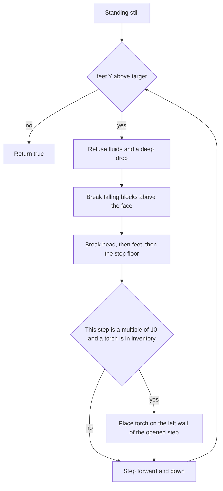

# digStairs skill

The stair shape follows the choice already made: each cycle opens only the next step. From where the bot stands, it breaks the two blocks directly in front (feet and head) and the floor of that step, then moves one block forward and one block down. It repeats until its feet are at the target Y. Those blocks are adjacent, so they are mined from the current stance, inside normal reach, before the bot steps.

## TODOs

- [x] Save this plan to plans/dig-stairs-skill.md
- [x] Add digStairs in src/agent/library/skills.js: direction parsing, one-step stair loop, strongest pickaxe, left-wall torches every 10 steps
- [x] Register !digStairs(direction, y) in src/agent/commands/actions.js

## API

Add `digStairs` in [src/agent/library/skills.js](src/agent/library/skills.js), beside `digDown`. The JSDoc stays inside the function and closes with `**/`, which is what [src/agent/library/index.js](src/agent/library/index.js) reads.

```js
await skills.digStairs(bot, "+x", 32);
```

- `direction` is `"+x"`, `"-x"`, `"+z"`, or `"-z"`. `"x"` and `"z"` mean the positive axis. Matching is case-insensitive. Anything else logs the accepted forms and returns `false`.
- `y` is an absolute feet Y. The loop stops when `floor(feet Y)` is at or below that value. Already there returns `true` without digging. A target above the current feet logs and returns `false`.
- Returns `true` only when the feet reach the target Y.

Direction and the left-hand wall (facing the bore, left is the cross product with up):

- `+x`: step `(1, 0)`, left wall is `-z` (`north`)
- `-x`: step `(-1, 0)`, left wall is `+z` (`south`)
- `+z`: step `(0, 1)`, left wall is `+x` (`east`)
- `-z`: step `(0, -1)`, left wall is `-x` (`west`)

Feet block is `Math.floor` of position, with a tiny Y epsilon so a foot height of `63.999` still counts as `64`.

## One step



Before breaking anything on that step, stop and return `false` if:

- the head block, feet block, or floor block is water or lava
- the block under the new floor is water or lava
- the drop under the new floor is more than 2 air blocks, same limit as `digDown`
- the next floor would be below the world bottom, or the chunk is unloaded

Break order is top-down so gravel and sand fall into the pick: the falling stack directly above the face (sand, red sand, gravel, and `*_concrete_powder`, capped at 8), then the head block in front, then the feet block in front, then the floor. Passable blocks (`air`, `cave_air`, `void_air`, and the same plants `placeBlock` already treats as empty) count as already clear. A block that cannot be harvested, or that is not diggable, stops the stair. The log includes how far the feet got.

Movement onto the opened step uses `pf.goals.GoalBlock` with `canDig` and `canPlaceOn` turned off, so pathfinding walks into the hole instead of mining a different route. `goToPosition` is the wrong helper here: its default stop distance is 2. In cheat mode, breaking uses `/setblock ... air` and the step uses `/tp`, matching `breakBlockAt` and `goToPosition`. If the feet Y does not drop by 1, the skill stops.

## Pickaxe

At the start of every step, equip the strongest pickaxe in the inventory. This does not call `bot.tool.equipForBlock`, because that helper picks the fastest legal tool and can swap in a shovel or a golden pick.

Descending order: netherite, diamond, iron, stone, golden, wooden. Same material: keep the one with the most remaining durability (`maxDurability - durabilityUsed`). A pickaxe with no durability left is skipped. With no usable pickaxe, dig with the empty hand and stop on the first block `canHarvest` rejects. Creative mode still equips the best pickaxe, and still digs when the harvest check would fail, matching `breakBlockAt`. After a torch placement, the next step equips the pickaxe again.

## Torches

"Equipped" means present in the inventory. Every 10th step (10, 20, 30, ...), if `torch` is in the inventory, place one on the left wall of the step just opened, before stepping into it. Prefer the head-height block of that step, attached with `placeBlock`'s `placeOn` set to the left face (`north`, `south`, `east`, or `west`). If that neighbor is not solid, try the feet-height block of the same step. If neither neighbor is solid, or placement fails, log it and keep digging. Torches are non-solid, so the following one-block step still fits.

## Command

Add `!digStairs` in [src/agent/commands/actions.js](src/agent/commands/actions.js) next to `!digDown`, via `runAsAction`:

- `direction` string, described as `"+x"`, `"-x"`, `"+z"`, or `"-z"`
- `y` int, domain `[-64, 320, "[]"]` so both ends are accepted

Chat form: `!digStairs("+x", 32)`. The skill doc is enough for `!newAction` code. No profile prompt changes.
